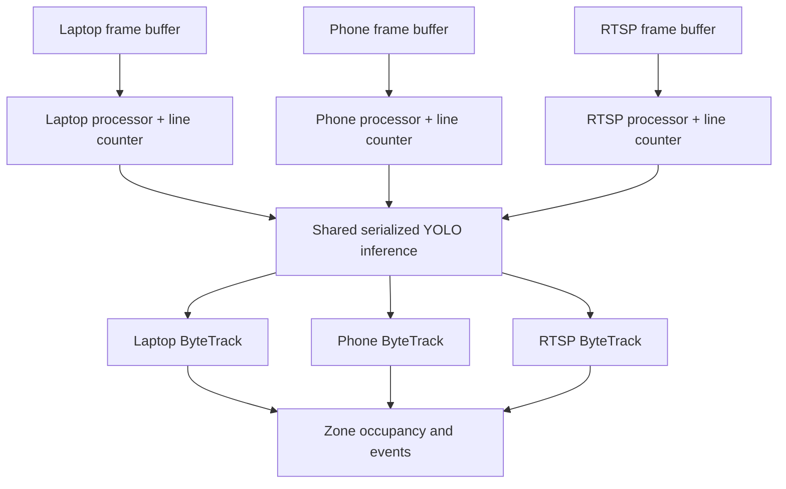

# Camera Flow and End-to-End Test Manual

This manual describes the implementation in this repository and the current trusted-LAN deployment at `192.168.1.6`. It separates automated verification from tests that require a physical webcam or phone.

## 1. Project overview and architecture

The system has a FastAPI backend, a React/Vite dashboard, MongoDB persistence, OpenCV camera capture, aiortc WebRTC reception, a shared YOLO11n model and independent ByteTrack/line-counting state per camera.

Important behavior:

- Every camera owns its own `LatestFrameBuffer`; only the newest frame is retained.
- One shared YOLO11n model is protected by an inference lock.
- Each camera ID has its own ByteTrack instance.
- Each `VideoProcessor` has its own `LineCounter`.
- Video is not sent through the application WebSockets. Processed previews use MJPEG at `/api/cameras/{camera_id}/stream`.
- Occupancy changes are broadcast through `/ws/occupancy` and persisted asynchronously.
- A camera becomes **Online** in the dashboard only after capture is running and an annotated frame has been produced. Before that it is **Connecting**.

### Laptop and RTSP pipeline

```mermaid
flowchart LR
    A[Laptop webcam or RTSP source] --> B[OpenCV capture thread]
    B --> C[Per-camera LatestFrameBuffer]
    C --> D[Per-camera VideoProcessor]
    D --> E[Shared YOLO11n model]
    E --> F[Per-camera ByteTrack]
    F --> G[Per-camera virtual LineCounter]
    G --> H[OccupancyService]
    H --> I[Bounded persistence queue]
    I --> J[(MongoDB)]
    H --> K[/ws/occupancy]
    D --> L[Annotated preview buffer]
    L --> M[/api/cameras/id/stream]
    M --> N[Live Monitoring]
```

### Phone WebRTC pipeline

```mermaid
flowchart LR
    A[iPhone or Android browser] -->|HTTPS page + explicit permission| B[getUserMedia]
    B -->|Encrypted WebRTC video| C[aiortc RTCPeerConnection]
    C --> D[Decoded VideoFrame]
    D --> E[MobileCamera.receive]
    E --> F[Per-camera LatestFrameBuffer]
    F --> G[Existing shared processing pipeline]
    G --> H[Annotated MJPEG preview]
    H --> I[Live Monitoring phone camera card]
```



### Multi-camera isolation



## 2. Hardware and software prerequisites

Use a Windows PowerShell terminal unless a step explicitly says to use the browser.

- Windows laptop at `192.168.1.6`.
- Python virtual environment at `D:\Department-Occupancy-Tracking\venv`.
- Node.js/npm.
- MongoDB Community Server or a configured MongoDB deployment.
- NVIDIA driver plus the existing CUDA-enabled PyTorch installation for RTX 3050 acceleration.
- `yolo11n.pt` in the project root, unless `YOLO_MODEL_PATH` points elsewhere.
- Laptop and phone on the same trusted Wi-Fi. Guest/client-isolated Wi-Fi will not work.
- mkcert certificate trusted by Windows and the phone. The configured certificate must cover `192.168.1.6`.

Do not reinstall generic PyTorch from PyPI over the working CUDA build.

## 3. Configuration verification

Open `.env` locally but never paste its secret values into chat, screenshots or source control. Confirm these names are present:

```dotenv
HOST=0.0.0.0
PORT=8000
CORS_ORIGINS=https://192.168.1.6:5173
PHONE_FRONTEND_URL=https://192.168.1.6:5173
PAIRING_TTL_SECONDS=120
WEBRTC_RECONNECT_GRACE_SECONDS=300
DATABASE_URL=mongodb://127.0.0.1:27017
YOLO_DEVICE=auto
```

Confirm `frontend/.env` or `frontend/.env.local` contains:

```dotenv
VITE_HOST=0.0.0.0
VITE_API_URL=https://192.168.1.6:8000/api
VITE_WS_URL=wss://192.168.1.6:8000
VITE_HTTPS_CERT=D:/Department-Occupancy-Tracking/.certs/lan.pem
VITE_HTTPS_KEY=D:/Department-Occupancy-Tracking/.certs/lan-key.pem
```

Success: every browser-facing URL uses `192.168.1.6` and HTTPS/WSS. Failure: mixing `localhost` with the LAN origin causes CORS failures and creates QR URLs the phone cannot reach.

## 4. MongoDB startup and verification

Open **PowerShell Terminal 1** as Administrator if the MongoDB service requires elevation:

```powershell
Get-Service MongoDB
Start-Service MongoDB
Get-Service MongoDB
```

Success: the final status is `Running`. If the service name is different, use Windows Services (`services.msc`) to find the installed MongoDB service. For Atlas, do not run `Start-Service`; instead verify the Atlas URI, IP allowlist and credentials in `.env`.

Optional shell ping:

```powershell
mongosh "mongodb://127.0.0.1:27017" --eval "db.adminCommand({ ping: 1 })"
```

Expected success contains `ok: 1`. If `mongosh` is not installed, use MongoDB Compass in section 25.

## 5. Backend startup

Open **PowerShell Terminal 2**:

```powershell
Set-Location D:\Department-Occupancy-Tracking
.\venv\Scripts\Activate.ps1
pip install -r backend\requirements.txt
uvicorn backend.main:app --host 0.0.0.0 --port 8000 --ssl-certfile .certs\lan.pem --ssl-keyfile .certs\lan-key.pem
```

Success:

- Uvicorn reports that application startup completed.
- Opening `https://192.168.1.6:8000/api/health` returns JSON with `"status":"healthy"`.
- `database` is `connected` when MongoDB is available. `development-memory` means events will not survive restart.

Failure actions:

- Certificate error: verify `.certs/lan.pem` and `.certs/lan-key.pem` exist and that the CA is trusted. Do not regenerate them unless they are invalid or do not contain the LAN IP.
- Port occupied: run `Get-NetTCPConnection -LocalPort 8000` and stop only the known stale application process.
- MongoDB fallback: fix `DATABASE_URL`, start MongoDB and restart FastAPI.

## 6. CUDA and model verification

In **Terminal 2** or another activated project terminal:

```powershell
.\venv\Scripts\python.exe -c "import torch; print('PyTorch:', torch.__version__); print('CUDA:', torch.cuda.is_available()); print('GPU:', torch.cuda.get_device_name(0) if torch.cuda.is_available() else 'CPU')"
```

Success on this laptop: CUDA is `True` and the GPU name identifies the RTX 3050. After the first processed frame, open **Settings** in the dashboard. CUDA should say **Available**, and GPU should report the NVIDIA device. `/api/system/status` also reports the model device after it loads.

If CUDA is false, do not claim GPU inference. Check the NVIDIA driver and the installed PyTorch build. The backend safely falls back to CPU when CUDA initialization fails.

## 7. Frontend startup

Open **PowerShell Terminal 3**:

```powershell
Set-Location D:\Department-Occupancy-Tracking\frontend
npm install
npm run dev
```

Success: Vite reports an HTTPS network URL for `https://192.168.1.6:5173`. Always open that URL. Do not use `https://localhost:5173` for this deployment.

If the page cannot call the backend, check the browser Console and Network tabs, then compare the exact origin with `CORS_ORIGINS`.

## 8. Login procedure

1. On the laptop browser, open `https://192.168.1.6:5173`.
2. The login page contains **Administrator API Key**; there is no email or user-account field.
3. Enter the value configured as `API_AUTH_SECRET` in the local backend `.env`.
4. Select **Sign In**.

Success: the **Overview** dashboard opens. The key remains only in frontend memory and is cleared by refresh/logout. Failure: “API key was rejected or the backend is unavailable.” Verify `/api/admin/verify`, the backend, certificate and key without printing the key.

## 9. Camera Management page

Open **Camera Management** from the left sidebar. The table is populated by `GET /api/cameras`; it is not mock data.

Controls:

- **Laptop Camera** opens the generic camera form. Its default type is **Laptop Webcam**, but it can also register legacy HTTP/RTSP sources.
- **Phone Camera** opens the QR/WebRTC workflow.
- Triangle icon: start a registered camera.
- Square icon: stop the camera and release processor/tracker resources.
- Pencil icon: edit configuration.
- Trash icon: delete the camera after confirmation.

Statuses:

- **Offline**: stopped, failed, or processing error.
- **Connecting**: capture/connection is starting or raw frames exist but no processed preview has been produced yet.
- **Online**: capture is running and the AI processor has produced an annotated frame.

## 10. Register a laptop camera

1. Close Windows Camera, Teams, Zoom and other programs using the webcam.
2. In **Camera Management**, select **Laptop Camera**.
3. Keep **Camera type** set to **Laptop Webcam**.
4. Select **Discover laptop cameras**. Expected result: “Available device indices: 0” or another integer.
5. Enter a descriptive **Camera name**, stable **Camera ID**, and **Zone** such as `department-a`.
6. Enter the discovered **Device index**, usually `0`.
7. Start conservatively with Width `1280`, Height `720`, Target FPS `15`.
8. Keep the initial line at `(0.1, 0.5)` to `(0.9, 0.5)` unless calibration requires another position.
9. Select **Save camera**.

Success: a laptop-camera row appears. Failure: duplicate ID returns a conflict; duplicate laptop device index is intentionally rejected.

## 11. Start and verify the laptop camera

1. Select the triangle Start icon in the laptop row.
2. Expect **Connecting**, then **Online** after an annotated frame is ready.
3. Open **Live Monitoring**.
4. There is no separate camera selector: every registered camera appears as its own card. Locate the card by camera name/zone.

Success: the card shows continuous processed video. A green counting line is visible. Detected people have red boxes and labels such as `ID 1`.

Failure actions:

- Stays Connecting with no capture FPS: verify Windows **Privacy & security → Camera**, close competing applications and test another device index.
- Capture FPS exists but never becomes Online: inspect backend logs for model/processing errors and open `GET /api/system/status`.
- Preview temporarily fails: Live Monitoring retries automatically every two seconds.

## 12. Person detection and ByteTrack verification

Stand fully inside the camera view under reasonable lighting.

Success indicators:

- A red rectangle surrounds a detected person.
- `ID n` appears above the rectangle.
- The ID should remain stable during a continuous visible track; it may change after leaving/re-entering or occlusion.
- Camera Management and Live Monitoring show measured capture FPS, processing FPS and latency. These are measurements, not guaranteed targets.

The system performs anonymous tracking only. It does not identify names, faces or biometrics.

## 13. Configure and test the virtual line

1. In **Camera Management**, select the pencil icon for the camera.
2. Set **Line start X/Y** and **Line end X/Y** using normalized values from `0` to `1`.
3. The line should cross the doorway perpendicular to travel.
4. Choose **Entry side**. If results are reversed, switch Positive/Negative.
5. Keep **Cooldown seconds** at `2` initially and **Hysteresis** around `0.01`.
6. Select **Save camera**; a running camera restarts with clean processor/tracker state.
7. Cross completely from one side of the green line to the other while remaining visible.

Success: **Overview** occupancy changes, **Events** receives an ENTRY/EXIT row, and the WebSocket updates the UI without a manual refresh. Touching the line without crossing should not count.

## 14. Phone QR pairing

Before pairing, verify the phone can open `https://192.168.1.6:5173` without a certificate warning.

1. In laptop **Camera Management**, select **Phone Camera** beside **Laptop Camera**.
2. Enter a camera name, stable camera ID and the intended zone.
3. Select **Create pairing session**.
4. A real QR code and a `120s to pair` countdown appear.
5. Scan it before expiry. The token is one-use and is stored hashed by the backend.

Success: the phone opens `/mobile-camera/{pairing-session-id}` on the trusted frontend origin. The token stays in the URL fragment and is not part of the initial server request.

Failure:

- QR contains localhost/wrong IP: fix `PHONE_FRONTEND_URL`, restart the backend and create a new session.
- Pairing expired: select **Create new pairing**; do not increase active-stream duration because the timer applies only before claim.

## 15. iPhone setup and permission

1. Connect the iPhone to the same Wi-Fi as the laptop.
2. Install and fully trust the mkcert root CA under **Settings → General → VPN & Device Management**, then **Settings → General → About → Certificate Trust Settings**.
3. Scan the QR using the Camera app and open it in Safari.
4. On the phone page, select **Start streaming**.
5. When Safari asks, choose **Allow** camera access.
6. The environment/rear camera is preferred. Use **Switch camera** if needed.

Success: the local phone preview appears, then status progresses through Establishing WebRTC, WebRTC connected and Camera connected.

iOS limitation: keep Safari foregrounded and prevent Auto-Lock during long tests. iOS may suspend browser video when locked/backgrounded; the application cannot bypass this operating-system behavior.

## 16. Android setup and permission

1. Connect Android to the same trusted Wi-Fi.
2. Install/trust the local CA according to the device’s **Security → Install CA certificate** workflow.
3. Scan the QR and open it in Chrome.
4. Select **Start streaming**, then **Allow while using this site**.
5. Use **Switch camera** if the wrong lens is selected.

Do not continue through a certificate warning. `getUserMedia` requires a trusted secure context.

## 17. Verify WebRTC and the first backend frame

Watch both the phone page and laptop pairing dialog.

Milestones are distinct:

1. **Establishing WebRTC**: offer/answer and ICE are in progress.
2. **WebRTC connected — waiting for backend video**: transport connected, but this alone is not accepted as a camera frame.
3. **Camera connected — backend is receiving video**: aiortc decoded a frame and `MobileCamera.receive()` accepted it.
4. **Online** in Camera Management/Live Monitoring: YOLO/ByteTrack processing generated an annotated preview.

Backend API checks from an authenticated browser session or Swagger:

- `GET /api/cameras` should contain the phone camera with `type: mobile` and `source: webrtc://{camera_id}`.
- `capture_fps` should rise above zero after frames arrive.
- `processing_status` becomes `active` after an annotated preview.
- `GET /api/system/performance` should show the camera ID with nonzero `frames_processed`.

Never paste the bearer pairing token into a terminal history or report.

## 18. Find the phone in Live Monitoring

1. On the laptop sidebar, open **Live Monitoring**.
2. Keep the filter at **All Cameras**, or select **Online** after processing starts.
3. Locate the card matching the phone camera name and zone. There is no hidden selection menu.
4. The card’s image comes from `/api/cameras/{camera_id}/stream` and contains processed frames only.

Success: phone video shows the green line, red boxes and anonymous IDs. If the camera is present in Camera Management but absent under the Online filter, switch to All Cameras and inspect whether it is Connecting/Offline.

## 19. Phone entry/exit counting test

1. Mount the phone securely so the doorway and full body path are visible.
2. Edit the phone camera line in **Camera Management** if necessary.
3. Walk across the line once, remain visible, then wait beyond the cooldown.
4. Walk back across.
5. Check **Overview** and **Events**.

Success: one ENTRY and one EXIT appear with the phone camera ID and zone. Occupancy never becomes negative. If direction is reversed, change **Entry side** rather than changing event data.

## 20. MongoDB Compass verification

1. Open MongoDB Compass.
2. Connect using the same server/database configured in `.env`; do not expose credentials in screenshots.
3. Open database `occupancy_tracking` unless `DATABASE_NAME` specifies another name.
4. Inspect:

   - `cameras`: persistent camera configuration; temporary pairing tokens are not stored here.
   - `occupancy_events`: `zone_id`, `camera_id`, `event_type`, anonymous `track_id`, UTC `timestamp`.
   - `occupancy_snapshots`: periodic zone occupancy recovery state.
   - `occupancy_corrections`: audited manual corrections.

Success: the test crossing appears in `occupancy_events`, and snapshots appear after the configured interval. If collections remain empty while `/api/health` says `development-memory`, fix MongoDB before testing persistence.

## 21. WebSocket verification

Use the laptop browser DevTools:

1. Press F12 → **Network** → filter **WS**.
2. Reload/sign in and locate `wss://192.168.1.6:8000/ws/occupancy`.
3. Inspect Messages.

Expected messages:

- `heartbeat` contains current occupancy state.
- `occupancy` is sent after a confirmed crossing.
- `correction` follows an administrator correction.

Camera-specific `/ws/cameras/{camera_id}` sends status/processing metadata but not video. MJPEG video remains an HTTP streaming response.

## 22. Simultaneous laptop and phone test

1. Start the laptop camera and wait for Online.
2. Pair/start the phone camera and wait for Online.
3. Open Live Monitoring with **All Cameras**.
4. Verify two distinct cards and independent capture/processing metrics.
5. Move a person in one camera at a time; confirm the other card is not overwritten.
6. Cross each configured line separately and verify each event’s `camera_id`.

Success: both previews update independently, tracker IDs are local to each camera, and occupancy events identify the correct source. A shared zone combines valid events by design.

## 23. Long-running phone test

This is a physical test and was not performed by the automated suite.

1. Keep the phone powered, cooled, on Wi-Fi and Safari/Chrome foregrounded.
2. Stream for the required duration.
3. Watch Duration, capture FPS, processing FPS and latency on the phone and laptop pairing dialog.
4. Periodically confirm Live Monitoring remains Online and `last frame` age remains low.

The 120-second QR expiry is ignored after the client claims the session. There is no active-stream timer. Actual duration is limited by browser/OS suspension, power, thermal state, Wi-Fi and server uptime.

## 24. Reconnection test

1. While streaming, briefly disable phone Wi-Fi for 5–10 seconds.
2. Re-enable the same Wi-Fi before `WEBRTC_RECONNECT_GRACE_SECONDS` elapses.
3. Leave the phone page open.

Expected status: Connection interrupted → Reconnecting → Camera connected → Online. Reconnection reuses the camera ID, processor, ByteTrack instance and line counter while atomically replacing the peer connection. It does not create a duplicate processor.

If the entire interruption exceeds the configured grace period, the backend marks it permanently closed and releases resources. Create a new pairing session.

## 25. Manual stop and cleanup

Phone page:

1. Select **Stop Camera**.
2. Expected: browser media tracks stop, peer closes, backend processor stops and camera becomes Offline.

Laptop dashboard:

1. In **Camera Management**, select the square Stop icon for the camera.
2. Expected: OpenCV/peer resources close, processor task ends, ByteTrack and performance state are released.

Deletion is separate: select the trash icon only when the persistent camera record should also be removed. No occupancy collections are deleted.

## 26. Common failures and exact actions

| Symptom | Meaning | Action |
| --- | --- | --- |
| Frontend CORS error | UI origin differs from allowed origin | Open only `https://192.168.1.6:5173`; set the exact same `CORS_ORIGINS`; restart backend |
| Phone camera permission unavailable | Untrusted/non-HTTPS origin | Trust the mkcert CA and verify the certificate covers `192.168.1.6` |
| QR opens localhost | Wrong `PHONE_FRONTEND_URL` | Set it to `https://192.168.1.6:5173`, restart backend, recreate QR |
| Pairing expires at 120 seconds | Phone did not claim token | Create a new pairing; active streams do not expire this way |
| WebRTC connected but Connecting remains | No decoded/processed frame yet | Keep page foregrounded; inspect capture FPS, backend logs and processing status |
| Camera row exists but card not under Online | Camera is Connecting/Offline | Use **All Cameras**, then resolve capture or processing error shown |
| Preview reports no frame | Processed MJPEG has not produced a frame or network failed | Wait for processing; Live Monitoring retries every two seconds; inspect `/api/system/performance` |
| Laptop camera cannot open | Device busy/wrong index/permission | Close other apps, enable Windows desktop camera permission, rediscover indices |
| Phone reconnect loops | Wi-Fi isolation, VPN, ICE route or expired grace | Disable VPN/client isolation; verify LAN reachability; configure TURN if required; recreate pairing after permanent close |
| Boxes appear but no counts | Line not crossed or track lost | Reposition/calibrate the line; improve lighting/view; cross fully and respect cooldown |
| MongoDB data missing | Backend in memory mode | Make `/api/health` report `connected`; fix MongoDB and restart backend |
| CUDA false | CPU PyTorch/driver problem | Verify driver and CUDA PyTorch; do not run generic `pip install torch` |
| Entry/exit reversed | Wrong line orientation | Toggle **Entry side** Positive/Negative |

## 27. Performance verification

Open **Settings**, **Camera Management**, **Live Monitoring**, and `GET /api/system/performance`.

Verify:

- GPU name and CUDA availability.
- Capture FPS is a recent two-second measurement.
- Processing FPS is a recent two-second measurement, not a lifetime average.
- Average inference and total latency are measured values.
- Persistence queue remains well below its configured bound.
- GPU allocated/reserved memory is reported when CUDA is active.

Inference runs in a worker thread, not directly on the FastAPI event loop. Frame buffers hold one newest frame, so slow inference drops stale frames rather than building latency.

Do not interpret one short test as a guaranteed FPS/latency value. Resolution, codec, network, stream count, temperature and GPU contention all matter.

## 28. Automated verification

Open **PowerShell Terminal 4**:

```powershell
Set-Location D:\Department-Occupancy-Tracking
.\venv\Scripts\python.exe -m pytest -q
.\venv\Scripts\python.exe -m pip check
.\venv\Scripts\python.exe -m compileall -q backend tests
Set-Location frontend
npm run build
npm run lint
npm audit --omit=dev
```

Automated WebRTC tests negotiate real local aiortc peers and deliver a synthetic video track through the shared processor. They do not prove physical iPhone, laptop camera, LAN, certificate or MongoDB hardware behavior.

Optional real laptop hardware test:

```powershell
Set-Location D:\Department-Occupancy-Tracking
$env:RUN_HARDWARE_TESTS='1'
.\venv\Scripts\python.exe -m pytest -q tests\test_hardware_optional.py
Remove-Item Env:RUN_HARDWARE_TESTS
```

## 29. Security verification

- Never put `API_AUTH_SECRET` in a QR URL or mobile JavaScript.
- Never print pairing tokens, TURN credentials, MongoDB credentials or certificate private keys.
- Pairing tokens are random, hashed, one-use and checked on signaling requests.
- Keep CORS restricted to the exact trusted frontend origin.
- Do not port-forward ports 5173/8000 to the public internet.
- Raw video is not permanently recorded by default.
- Read-only camera endpoints and WebSockets are LAN-visible in the current architecture; public deployment requires an identity-aware reverse proxy and network controls.

## 30. Final end-to-end acceptance checklist

Mark physical items only after performing them:

- [ ] MongoDB service is running and `/api/health` reports `connected`.
- [ ] Backend is running on trusted `https://192.168.1.6:8000`.
- [ ] Frontend is running and opened at `https://192.168.1.6:5173`.
- [ ] Administrator API-key login succeeds.
- [ ] Laptop camera registers, starts and becomes Online.
- [ ] Laptop processed preview shows boxes, IDs and green line.
- [ ] Laptop line crossing creates correct ENTRY/EXIT events.
- [ ] Phone scans the one-time QR and grants camera permission.
- [ ] Phone reaches Camera connected only after a decoded frame.
- [ ] Phone becomes Online after an annotated frame.
- [ ] Phone card is visible in Live Monitoring under All Cameras/Online.
- [ ] Phone preview shows boxes, IDs and green line.
- [ ] Phone line crossing creates correct ENTRY/EXIT events.
- [ ] Both cameras run simultaneously without overwriting each other.
- [ ] `/ws/occupancy` sends live updates without manual refresh.
- [ ] MongoDB Compass contains the camera event with correct camera and zone.
- [ ] Temporary phone Wi-Fi loss reconnects without a duplicate processor.
- [ ] Long-running phone session remains active with no arbitrary timer.
- [ ] Stop Camera releases media, processor, tracker and metrics.

## 31. Verified versus not physically verified

The automated suite verifies configuration validation, independent buffers/tracker selection, counting, occupancy, repository behavior, REST/WebSocket behavior, pairing security, real local aiortc negotiation, decoded frame delivery, reconnection without a duplicate processor, manual stop and cleanup.

The following require the operator to run the procedures above and must not be inferred from automated tests:

- Physical RTX 3050 inference performance on the current run.
- Physical laptop webcam capture.
- Physical iPhone/Android camera permission and long-duration behavior.
- Current Wi-Fi/firewall/ICE conditions.
- Current MongoDB service/Compass persistence.
